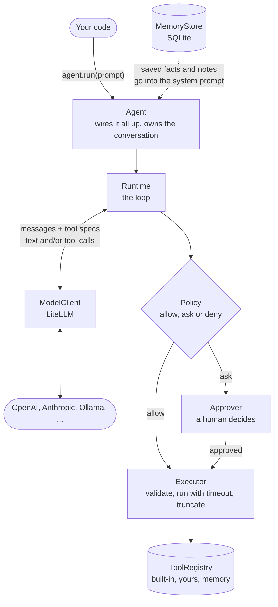
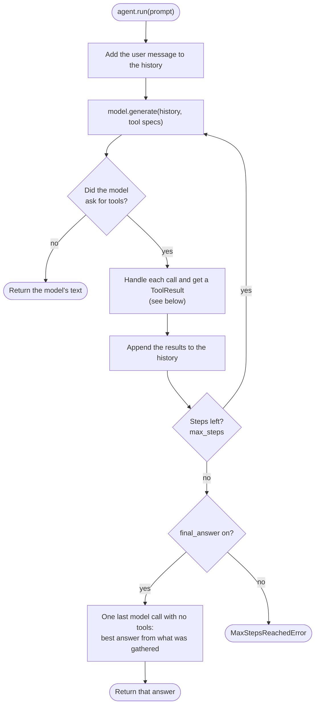
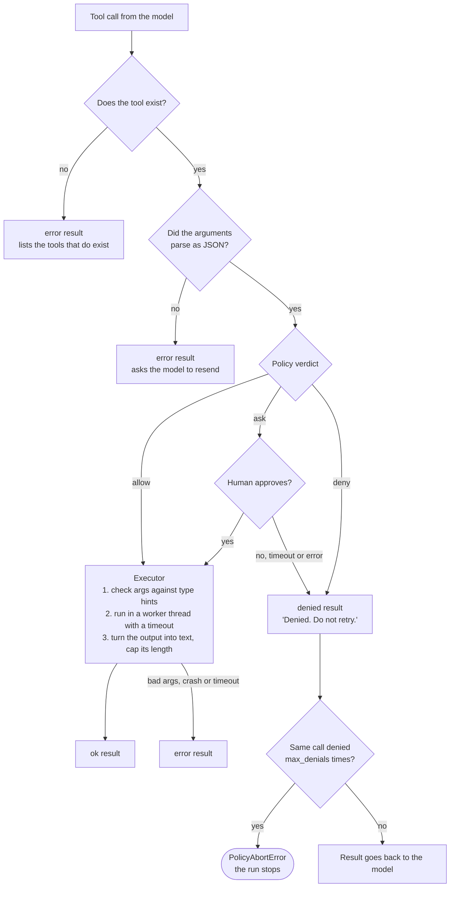

# Nova-Harness guide

The full reference for Nova-Harness. For the short introduction, see the [README](https://github.com/HmedNejjar/Nova/blob/nova-harness/README.md).

## What is this?

An LLM on its own only produces text. An **agent** lets it act: read files, run commands, browse the web. The part of the system that sits between the model and those actions is the **harness**.

Nova-Harness is that part, kept small enough to read in one sitting (about 1,900 lines of source). It runs the loop, validates what the model asks for, enforces what it is allowed to do, asks a human when it matters, and remembers things between conversations.

```python
from NovaHarness.harness import Agent

agent = Agent("gpt-4o-mini")   # any LiteLLM model string
print(agent.run("Which Python files in this folder have a TODO in them?"))
```

**Highlights**

- **Any model.** OpenAI, Anthropic, Ollama and every other provider LiteLLM supports, or bring your own client.
- **Write a tool in five lines.** Decorate a typed function with `@tool`; the JSON Schema is built from its signature.
- **Three-way policies.** Every tool is `allow`, `ask`, or `deny`. Strictest rule wins.
- **Human in the loop.** `ask` tools pause for a `y/n` with a live countdown. No answer means no.
- **Safe by default.** Reads run freely. Writes, shell commands, and network access ask first.
- **Persistent memory.** A SQLite store of facts and notes is injected into each new conversation.
- **Errors the model can fix.** Bad arguments, unknown tools and tool crashes go back to the model as results, not exceptions.
- **Tested offline.** The suite runs against scripted fake models. No API key needed.

## Contents

[Install](#install) · [Imports](#imports) · [Quickstart](#quickstart) · [How it works](#how-it-works) · [Built-in tools](#built-in-tools) · [Write your own tool](#write-your-own-tool) · [Policies](#policies) · [Approvals](#approvals) · [Memory](#memory) · [Models](#models) · [Errors](#errors) · [Configuration](#configuration) · [Security model](#security-model) · [Project layout](#project-layout) · [Development](#development)

## Install

Requires Python 3.10 or newer.

```bash
pip install nova-harness
```

The package installs as `NovaHarness`, split into `NovaHarness.harness`, `NovaHarness.tools` and `NovaHarness.models` (see [Imports](#imports)). To work from source instead:

```bash
git clone -b nova-harness https://github.com/HmedNejjar/Nova.git
cd Nova
pip install -e ".[dev]"
```

Give LiteLLM the key for your provider, for example `export OPENAI_API_KEY=...`. For DuckDuckGo web search, install the extra: `pip install "nova-harness[search]"` (see [Built-in tools](#built-in-tools)).

## Imports

The package has three parts. Import each name from the part it belongs to:

| Import from | Names |
|---|---|
| `NovaHarness.harness` | `Agent`, `Policy`, `MemoryStore`, `ToolApprover`, `CLIApprover`, `Message`, `ModelResponse`, `ToolCall`, `ToolResult`, `ToolSpec`, and every error |
| `NovaHarness.tools` | `tool`, `Tool`, `ToolRegistry`, `default_tools`, `default_policy`, `ddgs_search`, `brave_search` |
| `NovaHarness.models` | `ModelClient`, `LiteLLMClient` |

```python
from NovaHarness.harness import Agent, Policy
from NovaHarness.tools import tool
```

The version is `NovaHarness.__version__`.

## Quickstart

```python
from NovaHarness.harness import Agent

agent = Agent("gpt-4o-mini", root="./my-project")   # root = the workspace the agent can touch

print(agent.run("List the files here, then summarize what this project does."))
print(agent.run("Now write that summary to SUMMARY.md"))   # same conversation, it remembers
```

The second request needs `write_file`, which asks first:

```text
Tool 'write_file' requires approval.
  reason: tool in ask list
  path: "SUMMARY.md"
  content: "# my-project\n\nA small ..."
  3600s left to answer          <- counts down live
Approve? [y/n]: _
```

`y`, `yes` or `true` approves. Anything else, a timeout, or a closed stdin denies. The model is told *Denied. Do not retry.*

Each `agent.run()` continues the same conversation. Call `agent.reset()` to start a fresh one.

## How it works

Four components do the work. The **Runtime** drives the loop, the **Policy** decides what may run, the **Approver** asks a human, and the **Executor** runs the tool safely.



### The loop



### Life of a tool call

Every call goes through the same gate, in this order.



Four things worth knowing:

- Every outcome becomes a `ToolResult` with status `ok`, `error` or `denied`. The model always sees what happened and can adapt.
- A model that keeps retrying the same denied call (same tool, same arguments) is stopped after `max_denials` attempts (default 3).
- At the step limit the harness makes one last call with no tools, asking for a best answer from what was gathered, and says clearly what is incomplete. The instruction is not saved to the history. Turn this off with `final_answer=False` to get `MaxStepsReachedError` instead.
- If a run is aborted mid-way, every pending tool call still gets a result (`Not run: the run was stopped.`), so the conversation stays valid and you can keep using the same agent.

## Built-in tools

| Tool | What it does | Default |
|---|---|:---:|
| `calculator` | Arithmetic via a restricted AST evaluator. Never `eval()`. Guards against `9**9**9`. | allow |
| `current_time` | Current local date and time, ISO 8601. | allow |
| `read_file` | Read a text file (first 50 KB; binaries refused). | allow |
| `list_directory` | List a folder. Folders end in `/`. Up to 200 entries. | allow |
| `find_files` | Find files by glob pattern, such as `*.py`. Up to 50 hits. | allow |
| `search_text` | Case-insensitive substring search, returned as `file:line: text`. | allow |
| `write_file` | Create or overwrite a text file (up to 100,000 chars). | **ask** |
| `run_command` | Run a shell command in the workspace (25 s limit). | **ask** |
| `fetch_url` | Fetch a web page and return its text. | **ask** |
| `web_search` | Search the web. Only exists if you plug in a search backend. | **ask** |

File tools are confined to `root`. Pass `root="./some/folder"` to choose the workspace (default: the current directory).

**Web search** is opt-in because it needs a backend:

```python
from NovaHarness.harness import Agent
from NovaHarness.tools import brave_search, ddgs_search

agent = Agent("gpt-4o-mini", search_fn=ddgs_search())    # DuckDuckGo, no key (pip install "nova-harness[search]")
agent = Agent("gpt-4o-mini", search_fn=brave_search())   # Brave, reads BRAVE_API_KEY
```

Any function `(query: str, max_results: int) -> list[(title, url, snippet)]` works as a backend.

## Write your own tool

Decorate a typed function with a docstring. The docstring becomes the tool description the model reads, and the type hints become its JSON Schema.

```python
from NovaHarness.harness import Agent
from NovaHarness.tools import tool

@tool
def word_count(text: str) -> int:
    """Count the words in a piece of text."""
    return len(text.split())

agent = Agent("gpt-4o-mini", tools=[word_count], policy={"word_count": "allow"})
```

Rules the decorator enforces (a broken tool fails at definition time with a `ToolDefinitionError`, not in the middle of a run):

- A non-empty docstring is required.
- Every parameter needs a type hint. `*args` and `**kwargs` are not supported.
- Supported types: `int`, `float`, `str`, `bool`, `None`, `list`, `tuple`, `set`, `dict`, plus `list[T]`, `set[T]`, `tuple[T, ...]`, `dict[str, T]` and unions like `str | None`.
- Parameters with defaults are optional for the model.

What happens at call time:

- The model's arguments are checked against your hints with Pydantic. Unknown, missing and wrongly typed arguments produce a specific message the model can use to fix its next call.
- Return anything. Strings pass through, `None` becomes `(no output)`, structured data becomes JSON, and long output is truncated at 10,000 characters.
- Raise `InvalidArgumentsError` or `ToolExecutionError` (both importable from `NovaHarness.harness`) for a clear message to the model. Any other exception is wrapped in a `ToolExecutionError` and reported to the model as `<tool>: <ExceptionType>: <message>`.
- A tool that runs longer than `tool_timeout` (default 30 s) returns a timeout error.
- A tool of yours with the same name as a built-in replaces it.

> **New tools ask by default.** A tool no rule mentions falls back to the policy default, which is `ask`. Add it to your policy as `allow` if it is safe to run unattended, as above.

## Policies

A policy maps tool names to one of three actions.

| Action | Meaning |
|---|---|
| `allow` | Run it. |
| `ask` | Pause and ask the approver. |
| `deny` | Never run it. The model is told no. |

If a tool appears in more than one list, **the strictest wins**: `deny` beats `ask` beats `allow`. A tool in no list gets `default` (`ask`).

```python
# Tweak the defaults: a dict overrides rules on top of the built-in policy.
agent = Agent("gpt-4o-mini", policy={
    "run_command": "deny",      # never touch the shell
    "write_file": "allow",      # trust it with the workspace
})

# Or take full control with your own Policy, which replaces the defaults entirely.
from NovaHarness.harness import Policy

agent = Agent("gpt-4o-mini", policy=Policy(
    allow=frozenset({"read_file", "list_directory", "calculator"}),
    default="deny",             # anything not listed is refused
))
```

With a dict, the memory tools stay on `ask` unless you override them. With a `Policy` object you own every rule, memory tools included.

## Approvals

When the policy says `ask`, the harness calls `approver.approve(tool_call, reason)` and waits for a `bool`. The default `CLIApprover` prints the call, counts down, and reads `y/n` from the terminal. Its timeout defaults to one hour.

- It shows each argument value in full up to 200 characters, with a note if it was cut.
- Argument values are printed as JSON strings, so a value cannot fake extra lines in the prompt.
- Timeout, end of input, or any error counts as **no**.
- A late answer to an earlier, timed-out question is thrown away, so a stray `y` can never approve a different call.

For a web UI, a chat bot, or a headless job, subclass `ToolApprover` and override `approve`:

```python
from NovaHarness.harness import Agent, ToolApprover

class HeadlessApprover(ToolApprover):
    """No human around: allow web fetches, refuse everything else."""
    def approve(self, tool_call, reason):
        return tool_call.tool_name == "fetch_url"

agent = Agent("gpt-4o-mini", approver=HeadlessApprover())
```

The base `ToolApprover` denies everything, so a forgotten override fails closed.

## Memory

Conversations start empty, but the agent can remember what matters. Memory is a SQLite file, `~/.nova_harness/memory.db` by default, read into the system prompt every time a conversation starts.

| | `facts` | `notes` |
|---|---|---|
| For | Durable things: name, preferences, setup | Short-lived context worth keeping |
| Max entries | 50 | 50 |
| Max value length | 200 chars | 1,000 chars |
| When full | Refuses the new key (delete one first) | Drops the oldest |
| In the prompt | All of them | Only the 5 most recent |

The model manages memory through two tools, `save_to_memory` and `delete_from_memory`. Both **ask** by default, so you approve what gets remembered. Keys are lowercased and limited to 50 characters. Saved memory is added to the prompt as data about the user, never as instructions.

```python
from NovaHarness.harness import Agent, MemoryStore

agent = Agent("gpt-4o-mini")                                    # default store
agent = Agent("gpt-4o-mini", memory=MemoryStore("memory.db"))   # your own file
agent = Agent("gpt-4o-mini", memory=False)                      # no memory at all
```

`agent.reset()` starts a new conversation and re-reads memory, so anything saved in the last one is already there.

## Models

Pass a LiteLLM model string. Extra keyword arguments go straight to LiteLLM.

```python
Agent("gpt-4o-mini")
Agent("anthropic/claude-sonnet-5-5", temperature=0.2, max_tokens=2000)
Agent("ollama_chat/llama3.1", api_base="http://localhost:11434")   # fully local
```

`LiteLLMClient` defaults to a 60 s request timeout and 2 retries. Provider failures (rate limit, auth, timeout) surface as `ModelError`. If a model sends broken tool arguments, the error goes back to the model so it can resend, rather than killing the run. Some local models reuse one tool-call id for every call, so the client makes unique ids where needed.

To use something else entirely, pass any object with a `generate` method:

```python
from NovaHarness.harness import Agent, ModelResponse

class EchoModel:
    def generate(self, messages, tools):
        return ModelResponse(response=f"you said: {messages[-1].content}")

agent = Agent(EchoModel(), use_default_tools=False, memory=False)
agent.run("hi")   # -> "you said: hi"
```

Scripted clients like this are how the test suite runs without a network.

## Errors

| Kind | Errors | What happens |
|---|---|---|
| **Recoverable** `ToolError` | `ToolNotFoundError`, `InvalidArgumentsError`, `ToolExecutionError` | Becomes an `error` result. The model reads it and tries again. |
| **Fatal** `StopRunError` | `PolicyAbortError`, `MaxStepsReachedError`, `ModelError` | Raised out of `agent.run()`. |
| **Setup** | `ToolDefinitionError` | Raised when a tool is defined or registered wrongly. |

All of them inherit from `HarnessError`.

```python
from NovaHarness.harness import MaxStepsReachedError, ModelError, PolicyAbortError

try:
    answer = agent.run("Refactor everything.")
except MaxStepsReachedError:
    ...   # step limit hit and no answer: final_answer=False, or the last call returned only tool calls
except PolicyAbortError:
    ...   # the model kept retrying a denied call
except ModelError:
    ...   # the provider call failed
```

## Configuration

Everything is an argument to `Agent`.

| Argument | Default | Description |
|---|---|---|
| `model` | required | A LiteLLM model string, or any object with `generate(messages, tools)`. |
| `tools` | `()` | Extra `@tool` functions. Same name as a built-in replaces it. |
| `policy` | `None` | A `dict` of overrides on the default policy, or a `Policy` that replaces it. |
| `use_default_tools` | `True` | Set `False` to drop all built-in tools. |
| `root` | `"."` | The workspace folder for file and shell tools. |
| `search_fn` | `None` | Search backend. Enables `web_search`. |
| `memory` | `True` | `True` for the default store, `False` for none, or your own `MemoryStore`. |
| `approver` | `CLIApprover()` | Who answers `ask` prompts. |
| `system_prompt` | `None` | Replaces the built-in system prompt. |
| `instructions` | `None` | Extra instructions appended to the built-in prompt. |
| `max_steps` | `20` | Model turns allowed per run. |
| `final_answer` | `True` | At the step limit, ask the model once for a best-effort answer instead of raising. |
| `max_denials` | `3` | Identical denied calls before `PolicyAbortError`. |
| `tool_timeout` | `30.0` | Seconds a tool may run. |
| `**model_kwargs` | | Passed to `LiteLLMClient`: `temperature`, `max_tokens`, `timeout`, `num_retries`, `api_base`, `api_key`, and so on. |

Whichever system prompt you use, saved memory is appended to it when a conversation starts.

## Security model

Nova-Harness assumes the model can be wrong, and that anything it reads (web pages, file contents) can try to steer it. The built-in prompt tells the model to treat tool results as data, not instructions. The code does not rely on that alone.

| Area | Protection |
|---|---|
| **Files** | Every path is resolved and must land inside `root`. `..`, absolute paths and symlinks that point outside are rejected. |
| **Shell** | Always `ask`. Commands over 200 characters are refused, so the text you approve is the text that runs. Runs with a 25 s limit, and on timeout the whole process tree is killed. Variables that look like secrets (`KEY`, `TOKEN`, `SECRET`, `PASSWORD`, `CREDENTIAL`) are removed from the environment. |
| **Network** | Always `ask`. Only `http` and `https`. The host must resolve to a public address, which blocks localhost, your LAN and cloud metadata services. Redirects are re-checked. Responses are capped at 500 KB and limited to text types. |
| **Calculator** | A whitelisted AST walker. Exponents and result sizes are capped. |
| **Approval** | Timeout, EOF and errors all deny. Late answers are discarded. |
| **Runaway models** | `max_steps` and `max_denials` bound every run. |
| **Memory** | Size-limited, and injected as data, not instructions. Writes ask by default. |

**Know the limits**

- `run_command` is gated by approval, not sandboxed. The workspace is its starting folder, not a jail: an approved command can reach anything your user account can. Read the command before you press `y`.
- `fetch_url` checks the address and then connects, so a DNS rebinding attack could slip between the two.
- Filtering secrets out of the environment is name-based, so it is a heuristic, not a guarantee.
- A timed-out tool stops being waited on, but Python cannot kill its worker thread. `run_command` cleans up its own processes. Your tools should keep their own work bounded.
- For `write_file`, the approval prompt shows the first 200 characters of the content.

## Project layout

```text
src/NovaHarness/
├── __init__.py          The three subpackages and __version__
├── py.typed             Marks the package as typed
├── harness/
│   ├── __init__.py      Public API: Agent, Policy, MemoryStore, approvers, messages, errors
│   ├── agent.py         Agent: the entry point that wires everything together
│   ├── runtime.py       The loop: model -> policy -> approval -> executor
│   ├── executor.py      Validates arguments, runs tools with a timeout, turns output into text
│   ├── policies.py      Policy and Decision: allow, ask, deny
│   ├── approval.py      ToolApprover and CLIApprover (live countdown prompt)
│   ├── memory.py        SQLite MemoryStore and the memory tools
│   ├── messages.py      Message, ToolCall, ToolResult, ModelResponse, ToolSpec
│   ├── state.py         ConversationState
│   ├── errors.py        The error hierarchy
│   └── _prompts.py      The default system prompt
├── models/
│   ├── __init__.py      Public API: ModelClient, LiteLLMClient
│   ├── base.py          The ModelClient protocol
│   └── modelClient.py   LiteLLMClient
└── tools/
    ├── __init__.py      Public API: tool, ToolRegistry, built-in tools, search backends
    ├── tool.py          The @tool decorator and JSON Schema builder
    ├── registry.py      ToolRegistry
    └── default_tools.py Built-in tools, search backends, and the default policy
tests/                  Offline test suite with fake models and approvers
```

## Development

```bash
pip install -e ".[dev]"

pytest          # the full suite, offline, no API key
ruff check .    # lint and import order (configured in pyproject.toml)
mypy            # type checking (configured in pyproject.toml)
```

Test your own tools and policies the same way the suite does: script a `FakeModelClient` (see `tests/fakes.py`) with the tool calls you want the "model" to make, and assert on what comes back.

## License

MIT, as declared in `pyproject.toml`. Built by Marhfoul Bakr.
