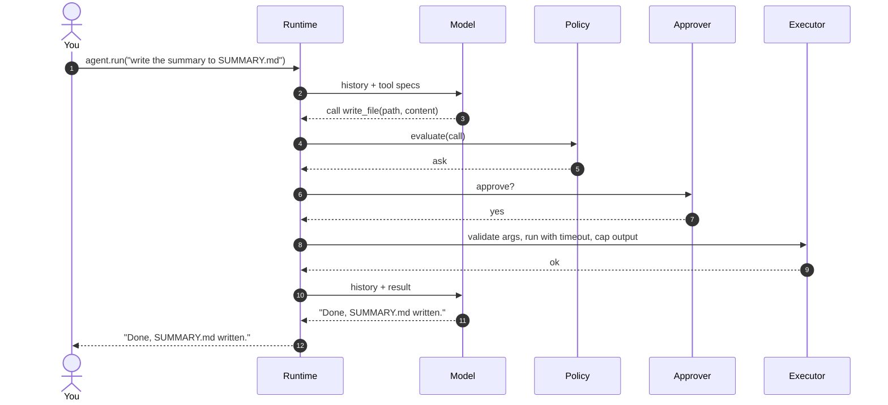
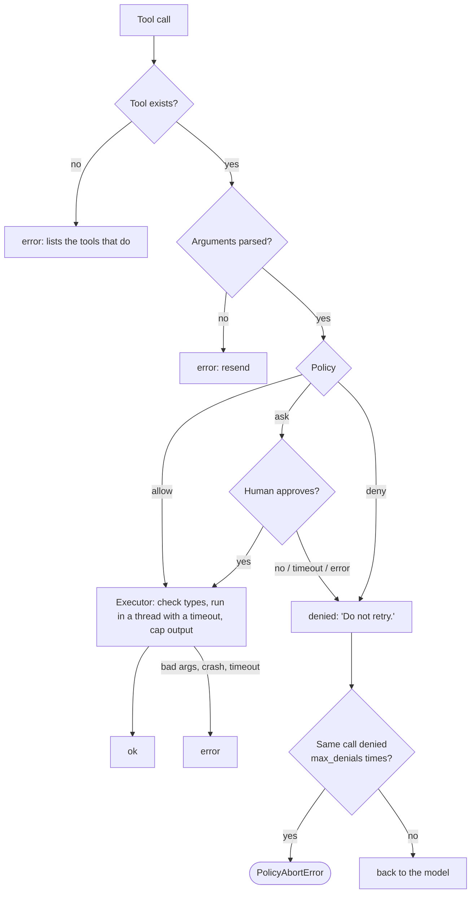

<p align="center">
  <picture>
    <source media="(prefers-color-scheme: dark)" srcset="https://raw.githubusercontent.com/HmedNejjar/Nova/nova-harness/assets/logo-dark.svg">
    <source media="(prefers-color-scheme: light)" srcset="https://raw.githubusercontent.com/HmedNejjar/Nova/nova-harness/assets/logo-light.svg">
    
  </picture>
</p>

<h3 align="center">Let a model do the work. Keep your hands on the controls.</h3>

<p align="center">
  Automation for any <a href="https://github.com/BerriAI/litellm">LiteLLM</a> model, with permissions and a human veto built in.
</p>

<p align="center">
  
  
  
  
</p>

```python
from NovaHarness.harness import Agent

agent = Agent("gpt-4o-mini", root="./my-project")
print(agent.run("Find every TODO in this project and write them to TODO.md"))
```

The agent reads and searches freely. When it wants to write `TODO.md`, it stops and asks you:

```text
Tool 'write_file' requires approval.
  reason: tool in ask list
  path: "TODO.md"
  content: "# TODOs\n\n- src/app.py:41: handle empty input\n..."
  3600s left to answer
Approve? [y/n]: _
```

That is the whole idea. The model proposes, the harness decides.

---

## Why a harness?

A model alone only writes text. To automate real work it needs to read files, run commands and browse, and every one of those is a way for it to go wrong. The harness is the layer in between:

- **It runs the loop.** Ask the model, run the tools it requests, feed results back, repeat until it answers.
- **It enforces the rules.** Every tool call is checked against a policy before it runs.
- **It keeps a human in charge.** Risky calls wait for a `y`. No answer means no.
- **It stays small.** About 1,900 lines, so you can read all of it before you trust it.

## Install

```bash
pip install nova-harness
```

Python 3.10 or newer. Give LiteLLM your provider key (`export OPENAI_API_KEY=...`) or point it at a local model. For DuckDuckGo web search: `pip install "nova-harness[search]"`.

<details>
<summary>Install from source</summary>

```bash
git clone -b nova-harness https://github.com/HmedNejjar/Nova.git
cd Nova
pip install -e ".[dev]"
pytest
```
</details>

## What a run looks like



Every outcome comes back to the model as a result, even failures. It sees `ok`, `error` (with a message it can act on) or `denied`, and adapts.

<details>
<summary>The full path of one tool call</summary>


</details>

## Safe by default

Reads run on their own. Anything that changes the world asks first.

| | Tools | Default |
|---|---|:---:|
| **Look** | `read_file` `list_directory` `find_files` `search_text` | allow |
| **Think** | `calculator` `current_time` | allow |
| **Change** | `write_file` `run_command` | ask |
| **Reach out** | `fetch_url` `web_search` | ask |
| **Remember** | `save_to_memory` `delete_from_memory` | ask |

File tools can only see the `root` folder you give the agent. `web_search` appears only when you plug in a search backend.

## Make it yours

### Add a tool

A typed function with a docstring. The docstring tells the model what it does, the type hints become its schema.

```python
from NovaHarness.harness import Agent
from NovaHarness.tools import tool

@tool
def word_count(text: str) -> int:
    """Count the words in a piece of text."""
    return len(text.split())

agent = Agent("gpt-4o-mini", tools=[word_count], policy={"word_count": "allow"})
```

Your tool asks for approval until a policy says otherwise, so a new tool is never silently trusted.

### Change the rules

```python
from NovaHarness.harness import Agent, Policy

# Adjust the defaults...
Agent("gpt-4o-mini", policy={"run_command": "deny", "write_file": "allow"})

# ...or write the rulebook yourself. Anything unlisted is refused.
Agent("gpt-4o-mini", policy=Policy(
    allow=frozenset({"read_file", "list_directory", "calculator"}),
    default="deny",
))
```

If a tool appears in more than one list, the strictest wins: `deny` beats `ask` beats `allow`.

### Change who answers

The default prompt is the terminal. For a web app, a bot, or a cron job, subclass `ToolApprover`:

```python
from NovaHarness.harness import Agent, ToolApprover

class HeadlessApprover(ToolApprover):
    def approve(self, tool_call, reason):
        return tool_call.tool_name == "fetch_url"   # fetch pages, nothing else

Agent("gpt-4o-mini", approver=HeadlessApprover())
```

The base class denies everything, so a forgotten override fails closed.

### Change the model

```python
from NovaHarness.harness import Agent

Agent("gpt-4o-mini")
Agent("anthropic/claude-sonnet-5-5", temperature=0.2)
Agent("ollama_chat/llama3.1", api_base="http://localhost:11434")   # fully local
```

Or pass any object with a `generate(messages, tools)` method. That is how the tests run without a network.

## It remembers

Conversations start empty, but the agent can keep what matters. Facts (name, preferences) and notes (recent context) live in a small SQLite file, `~/.nova_harness/memory.db`, and are loaded into the system prompt at the start of each conversation. The model saves them itself, and each save asks for your approval.

```python
from NovaHarness.harness import Agent, MemoryStore

Agent("gpt-4o-mini")                                    # default store
Agent("gpt-4o-mini", memory=MemoryStore("memory.db"))   # your own file
Agent("gpt-4o-mini", memory=False)                      # none
```

Facts are capped at 50 entries and refuse new ones when full. Notes are capped at 50, evict the oldest, and only the 5 most recent reach the prompt.

## What it guarantees

| | |
|---|---|
| **Files** | Paths are resolved and must stay inside `root`. `..`, absolute paths and escaping symlinks are rejected. |
| **Shell** | Always asks. Commands over 200 characters are refused, so the text you approve is the text that runs. 25 s limit, whole process tree killed on timeout. Variables named like secrets (`KEY`, `TOKEN`, `SECRET`, `PASSWORD`, `CREDENTIAL`) are stripped from its environment. |
| **Network** | Always asks. `http(s)` only, public addresses only (no localhost, LAN or cloud metadata), redirects re-checked, 500 KB cap. |
| **Approval** | Timeout, closed input or any error means no. A late answer to an old question can never approve a new one. |
| **Runaway models** | `max_steps` bounds every run. A model that keeps retrying a denied call is stopped after `max_denials`. |
| **Prompt injection** | Pages, files and memory are presented to the model as data, not instructions. |

**What it does not do.** `run_command` is gated by your approval, not sandboxed: an approved command can reach anything your account can, so read it before you press `y`. Secret filtering is by name, a heuristic. `fetch_url` resolves a host and then connects, which leaves a DNS rebinding gap. A timed-out tool is abandoned, not killed, because Python cannot stop a thread.

The full [security model](https://github.com/HmedNejjar/Nova/blob/nova-harness/GUIDE.md#security-model) is in the guide.

## Reference

<details>
<summary><b><code>Agent</code> options</b></summary>

| Option | Default | |
|---|---|---|
| `model` | required | LiteLLM model string, or any object with `generate()` |
| `tools` | `()` | Extra `@tool` functions (same name as a built-in replaces it) |
| `policy` | `None` | `dict` of overrides, or a `Policy` that replaces the defaults |
| `use_default_tools` | `True` | `False` drops the built-ins |
| `root` | `"."` | Workspace folder for file and shell tools |
| `search_fn` | `None` | Search backend; enables `web_search` |
| `memory` | `True` | `True`, `False`, or a `MemoryStore` |
| `approver` | `CLIApprover()` | Who answers `ask` prompts |
| `system_prompt` | `None` | Replace the built-in prompt |
| `instructions` | `None` | Append to the built-in prompt |
| `max_steps` | `20` | Model turns per run |
| `final_answer` | `True` | At the step limit, ask once for a best-effort answer instead of raising |
| `max_denials` | `3` | Identical denied calls before the run is aborted |
| `tool_timeout` | `30.0` | Seconds a tool may run |
| `**model_kwargs` | | Passed to LiteLLM: `temperature`, `max_tokens`, `api_base`, `api_key`, ... |

`agent.run(prompt)` continues the same conversation. `agent.reset()` starts a new one and re-reads memory.
</details>

<details>
<summary><b>Web search backends</b></summary>

```python
from NovaHarness.harness import Agent
from NovaHarness.tools import brave_search, ddgs_search

Agent("gpt-4o-mini", search_fn=ddgs_search())    # DuckDuckGo, no key
Agent("gpt-4o-mini", search_fn=brave_search())   # reads BRAVE_API_KEY
```

Any function `(query, max_results) -> [(title, url, snippet)]` works.
</details>

<details>
<summary><b>Errors</b></summary>

Everything inherits from `HarnessError`.

| | | What happens |
|---|---|---|
| Recoverable | `ToolNotFoundError` `InvalidArgumentsError` `ToolExecutionError` | Becomes an `error` result; the model retries |
| Fatal | `PolicyAbortError` `MaxStepsReachedError` `ModelError` | Raised out of `agent.run()` |
| Setup | `ToolDefinitionError` | Raised when a `@tool` is defined wrongly |

```python
from NovaHarness.harness import MaxStepsReachedError, ModelError, PolicyAbortError

try:
    agent.run("Refactor everything.")
except PolicyAbortError:
    ...   # the model kept retrying a denied call
except MaxStepsReachedError:
    ...   # out of steps and no answer (final_answer=False, or the last call returned only tool calls)
except ModelError:
    ...   # the provider call failed
```

If a run is aborted, every pending tool call still gets a result, so the conversation stays valid and the agent is reusable.
</details>

<details>
<summary><b>Project layout</b></summary>

```text
src/NovaHarness/
├── harness/   agent, runtime (the loop), executor, policies, approval, memory, messages, state, errors
├── models/    the ModelClient protocol and LiteLLMClient
└── tools/     @tool, ToolRegistry, built-in tools and the default policy
tests/         offline tests with scripted fake models and approvers
```
</details>

## Development

```bash
pip install -e ".[dev]"
pytest
```

The suite needs no API key. To test your own tools, script a `FakeModelClient` (see `tests/fakes.py`) with the calls you want the "model" to make and assert on what comes back.

For the full guide (tool rules, every option, the security model in depth), see [GUIDE.md](https://github.com/HmedNejjar/Nova/blob/nova-harness/GUIDE.md).

## License

MIT. Built by Marhfoul Bakr.
